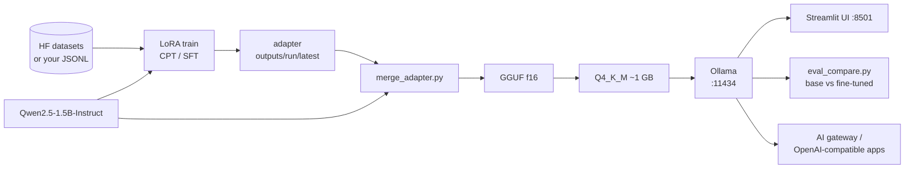

# qwen15b_cpu_sft_ollama

Fine-tune **Qwen2.5-1.5B-Instruct** with LoRA on CPU (or GPU), export to **GGUF**, serve with **Ollama**, chat in a **Streamlit** UI, and score it against the base model.



> "Instruction tuning" is still next-token prediction: the prompt tokens are masked (`-100`) so the loss only covers the assistant answer, including `<|im_end|>` so the model learns to stop.

## Quickstart (one command)

```bash
python3.12 -m venv .venv && source .venv/bin/activate
pip install --upgrade pip
pip install --index-url https://download.pytorch.org/whl/cpu torch   # CPU wheels (skip on GPU boxes)
pip install -e ".[dev]"

docker compose up -d                       # Ollama + UI (both bound to localhost)

# Train on the bundled sample data (swap in your own JSONL), export, register, smoke test:
./scripts/run_pipeline.sh configs/sft_lora_local_jsonl.yaml qwen15b-local
```

That runs: **train → merge → GGUF f16 → Q4_K_M → `ollama create` → test question**. llama.cpp is cloned and built automatically the first time.

Quick dry run first (minutes, not hours): `MAX_STEPS=10 ./scripts/run_pipeline.sh configs/sft_lora_local_jsonl.yaml qwen15b-try`

## Pick your data

| Config | Data | Use when |
|---|---|---|
| `configs/sft_lora_local_jsonl.yaml` | `data/sample_sft.jsonl` (20 platform-eng Q&A) or **your own** `{"question","answer"}` lines | You want the model to answer *your* way: runbooks, NOC incidents, internal FAQs |
| `configs/sft_lora_qwen15b_cpu_cloudqa.yaml` | 4 streaming HF datasets (DevOps, CNCF Q&A, Java) | General DevOps/cloud assistant demo |
| `configs/cpt_lora_qwen15b_cpu_cloudtext.yaml` | Raw domain text | Domain vocabulary first; then `scripts/run_train_cpt_then_sft.sh` |

Own data in another shape? Change `prompt_field` / `response_field` (and optional `input_field` for context). CSV/Parquet work too (`dataset_name: csv` + `data_files`).

## Use the model

```bash
# Ollama native API
curl http://localhost:11434/api/chat -d '{"model":"qwen15b-local","stream":false,
  "messages":[{"role":"user","content":"How do I debug CrashLoopBackOff?"}]}'

# OpenAI-compatible (any OpenAI SDK, LangChain, an AI gateway upstream)
curl http://localhost:11434/v1/chat/completions -H 'Content-Type: application/json' \
  -d '{"model":"qwen15b-local","messages":[{"role":"user","content":"What is a PDB?"}]}'
```

UI: <http://localhost:8501>. Pick the base model (`ollama pull qwen2.5:1.5b-instruct`) in the sidebar to compare side by side.

To reach it from other machines set `UI_BIND=0.0.0.0` (UI only). Keep Ollama on localhost or behind a gateway; it has no auth.

## Prove it got better

```bash
ollama pull qwen2.5:1.5b-instruct
python scripts/eval_compare.py --models qwen2.5:1.5b-instruct qwen15b-local \
  --prompts data/eval_prompts.jsonl --out reports/eval
open reports/eval/report.md     # per-question answers + keyword score + latency
```

`data/eval_prompts.jsonl` holds questions **not** in the training set, each with expected keywords. Add your own.
Works against any OpenAI-compatible endpoint (`--base-url`, `--api-key`).

## Monitor training

```bash
tail -f outputs/<run>.train.log
python -m json.tool outputs/<run>/status.json   # step, loss, loss_history, ETA, data_stats
./scripts/monitor_train.sh outputs/<run>
```

`data_stats` shows samples used per source and how many were skipped (prompt too long) or truncated, so a dataset with wrong field names shows up as `0`.

## Sizing (CPU)

| Box | 1.5B, LoRA, `max_length` 256–512, 150–600 steps | Notes |
|---|---|---|
| m5.8xlarge (16 physical cores, 128 GB) | ~1–4 h | `num_threads: 16`; vCPUs beyond physical cores don't help |
| m7i.8xlarge | faster; try `dtype: bfloat16` (AMX) | halves RAM |
| 1× GPU (g5/g6) | minutes | `device: auto`, `dtype: bfloat16` |

RAM: fp32 base 6 GB + activations. Merge needs ~2× model size. Ollama Q4_K_M inference: ~1.2 GB RAM.

## Test

```bash
pytest -q                     # 15 tests (tiny offline Qwen2 + UI vs fake Ollama), ~1 min, no downloads
./scripts/smoke_e2e.sh        # full train→merge→GGUF→quantize→llama-server→eval, offline, ~3 min
```

The tests build a tiny random model with Qwen2's architecture, special tokens and ChatML template, so every code path is real without pulling 3 GB of weights.

## Layout

```
configs/       training configs (YAML; no code edits for day-to-day changes)
data/          sample SFT data + held-out eval prompts
src/qwen15b_cpu_sft/  train loop, streaming data + masking, LoRA, tiny test model
scripts/       run_pipeline, merge, GGUF export/quantize, eval_compare, smoke_e2e, monitor
ollama/        Modelfile template (Qwen ChatML)
ui/            Streamlit chat
tests/         pytest suite
docs/REVIEW.md review findings and what was fixed
```

## Troubleshooting

- **401 from Hugging Face**: `huggingface-cli login` or `export HF_TOKEN=...` (never commit tokens).
- **"Dataset yields no usable samples"**: wrong field names or `data_files` path, or `max_length` too small for your prompts. The error prints `data_stats`.
- **Looks stuck after model download**: first streaming batch + tokenizer warm-up. If `ps -o time` keeps climbing it's working.
- **Model rambles / doesn't stop in Ollama**: you created it from an old Modelfile; recreate from `ollama/Modelfile.template` (has ChatML `TEMPLATE` + `stop`).
- **Rollback**: `docker compose down -v`, `rm -rf outputs/<run> merged gguf`, `ollama rm <model>`.

Model: [Qwen/Qwen2.5-1.5B-Instruct](https://huggingface.co/Qwen/Qwen2.5-1.5B-Instruct) (Apache-2.0). Check each dataset's license before using a fine-tuned model commercially.
